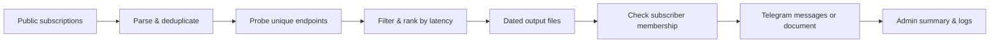

<div align="center">

# Telegram Proxy & Config Distributor

### Fresh sources. Measured latency. Delivered to Telegram.

An automated pipeline for collecting V2Ray configurations and MTProto proxies,<br>
ranking reachable endpoints, and sharing the results with your subscribers.

[](https://www.python.org/)
[](.github/workflows/notify-telegram.yml)
[](https://core.telegram.org/bots)
[](#state--privacy)

[Quick start](#quick-start) · [Connect your bot](#connect-your-bot) · [How it works](#how-it-works) · [Operations](#operations)

</div>

---

## A small pipeline with a clear purpose

Keep a Telegram community supplied with freshly collected connection links, without maintaining a dedicated server. GitHub Actions handles scheduled collection and distribution; the Python scripts also run locally when you want to inspect a subscription or export a smaller selection.

| Collect | Measure | Deliver | Observe |
| :--- | :--- | :--- | :--- |
| Read plain-text or Base64 subscriptions. | Probe each unique host and port once. | Split results into messages or attach a text file. | Track delivery counts, failures, and execution time. |
| Skip comments and duplicate labels. | Use up to 100 concurrent workers. | Check channel membership before broadcasting. | Keep timestamped logs and concise admin reports. |

> **What a passing result means:** the endpoint accepted a TCP connection from the machine running the test. This does not verify protocol authentication, credentials, traffic forwarding, or reachability from a subscriber's network, including networks in Iran.

## Quick start

Use **Python 3.12+** and run these commands from the repository root:

```bash
python3 -m venv .venv
source .venv/bin/activate
python -m pip install -r requirements.txt

# Fetch and rank configurations from the default source.
python main.py --mode 1 --source 3 --export all

# Fetch and rank Telegram MTProto proxies.
python main.py --mode 2 --source 3 --export all
```

Results are written to dated files, with a benchmark table beside them:

```text
config/                          proxy/
├── YYYY-MM-DD_config.txt        ├── YYYY-MM-DD_proxy.txt
└── README.md                    └── README.md
```

Output dates use **Tehran time (UTC+03:30)**. Previous daily files remain available; a failed fetch or an empty selection leaves existing output intact.

### Make the selection yours

```bash
# Keep the 50 fastest qualifying results from a local subscription.
python main.py --mode 1 --source 1 --input ./subscription.txt --export 50

# Read a different subscription URL.
python main.py --mode 1 --source 3 --input https://example.com/subscription.txt --export all

# Include optional country lookups.
python main.py --mode 1 --source 3 --export 50 --locations

# Open the interactive prompts.
python main.py
```

| Option | Values | Purpose |
| :--- | :--- | :--- |
| `--mode` | `1` / `2` | V2Ray configurations / MTProto proxies. |
| `--source` | `1` / `2` / `3` | Local file / clipboard / subscription URL. |
| `--input` | Path or URL | Override the input for file or URL mode. |
| `--export` | Positive integer or `all` | Limit the ranked selection. An out-of-range count exports all qualifying results. |
| `--locations` | Flag | Enable country lookups; disabled by default to avoid extra network dependencies. |

Clipboard output is attempted only in interactive mode. A missing clipboard service does not prevent file export.

## Connect your bot

### 1. Add repository secrets

Create a bot through [BotFather](https://t.me/BotFather), then open **Settings → Secrets and variables → Actions** in your GitHub repository.

| Secret | Purpose |
| :--- | :--- |
| `TELEGRAM_BOT_TOKEN` | Bot token issued by BotFather. |
| `DB_PASSWORD` | Strong password used to encrypt and decrypt the bot state in Actions. |
| `TELEGRAM_ADMIN_CHAT_ID` | Optional admin chat ID for delivery and subscription reports. |
| `TELEGRAM_CHANNEL_ID` | Required-membership channel; defaults to `@sentencedIntoMusic` when unset. |

Make the bot an **administrator of the required channel** so it can reliably check other users' membership.

### 2. Set the commands

Configure these commands through BotFather:

| Command | Action |
| :--- | :--- |
| `/start` | Check channel membership and activate a subscription. |
| `/getConfigs` | Activate a subscription using the same membership check. |
| `/stop` | Cancel a subscription. |

Commands are processed during the next polling run. `/getConfigs` activates a subscription; it does not trigger an immediate configuration broadcast.

### 3. Run the workflow

Open the repository's **Actions** tab, select **Telegram Notifier**, and choose **Run workflow**. Select `config`, `proxy`, or `both`; the default is `both`.

Scheduled runs fetch both sources **once a day**, at **00:00 UTC** — **03:30 in Tehran**. GitHub Actions may start scheduled jobs later than the requested time.

## How it works



### Sources

| Content | Upstream source | Download |
| :--- | :--- | :--- |
| V2Ray configurations | [barry-far/V2ray-Config](https://github.com/barry-far/V2ray-Config/blob/main/All_Configs_Sub.txt) | [All_Configs_Sub.txt](https://raw.githubusercontent.com/barry-far/V2ray-Config/main/All_Configs_Sub.txt) |
| MTProto proxies | [SoliSpirit/mtproto](https://github.com/SoliSpirit/mtproto) | [all_proxies.txt](https://raw.githubusercontent.com/SoliSpirit/mtproto/master/all_proxies.txt) |

### Parse once. Probe once. Rank the results.

The parser accepts plain text and Base64 subscriptions, including omitted Base64 padding. It skips comment lines and removes duplicate links whose only difference is the `#` label. Malformed records, invalid ports, and unsupported protocols are ignored.

Supported endpoint formats:

- **Configurations:** `vless://`, `trojan://`, `vmess://`, `ss://`, and `ssr://`.
- **MTProto:** `tg://proxy`, `https://t.me/proxy`, and `https://telegram.me/proxy`, with query parameters in any order.
- **Addresses:** hostnames, IPv4, and bracketed IPv6 where applicable.

Configurations sharing a host and port reuse a single probe result while retaining their separate connection settings. At most **100 workers and connections** are active at a time. UDP-based protocols such as Hysteria2 and TUIC are excluded from TCP testing.

| Setting | Configurations | MTProto proxies |
| :--- | :--- | :--- |
| Connection timeout | 3 seconds | 3 seconds |
| Selection threshold | Below 300 ms | Below 200 ms |
| Sort order | Lowest TCP latency first | Lowest TCP latency first |
| Broadcast selection | First 50 results | All results |

Source downloads have a timeout and up to **three attempts** with increasing delays for transient failures. If fetching fails, no supported links remain, or no endpoints meet the latency threshold, the collector exits with status `1`. Output files are replaced atomically, without deleting their parent directories.

### Delivery that adapts to the payload

Small selections arrive as HTML-formatted messages with special characters escaped. Each message holds up to **10 items**, with a **3,600 UTF-16-unit budget** for item text.

Selections requiring more than **15 messages**, or containing an item larger than the text budget, are delivered as a text document. The attachment contains the same selected items and channel labels as text delivery.

Telegram requests use up to **four attempts** for network failures, server errors, and rate limits. Rate-limit responses use `retry_after` with a bounded wait; permanent errors such as `400` and `403` are not retried. One recipient's delivery failure does not stop the rest of the broadcast.

A recipient counts as successfully reached only after every message part, or the document upload, is confirmed. If Telegram accepts a request but the response is lost, retrying may create a duplicate message; delivery is not guaranteed to happen exactly once.

## Operations

### Three workflows, one shared state

| Workflow | Trigger | Behavior |
| :--- | :--- | :--- |
| [Telegram Notifier](.github/workflows/notify-telegram.yml) | Daily or manual dispatch | Fetch both sources, poll commands, and broadcast the selected content. A collection failure stops that workflow run before delivery. |
| [Broadcast on update](.github/workflows/broadcast-on-config-update.yml) | Pushes changing `config/` or `proxy/`, or manual dispatch | Poll commands and distribute the changed content type. Manual runs distribute both. |
| [Check subscribers](.github/workflows/dry-run.yml) | Manual dispatch | Poll commands, check membership, and send an admin summary without broadcasting configurations. Command polling can still send replies to users. |

All three workflows share the `telegram-bot-state` concurrency group and check out the latest `main`. This prevents simultaneous workflow writes to encrypted state without cancelling a running job. GitHub's default concurrency behavior retains one pending run; a newer run can replace an older pending run.

<details>
<summary><strong>Polling and webhook behavior</strong></summary>

The Actions setup polls Telegram during workflow execution; it does not run a continuous bot process. Telegram retains pending updates for no more than 24 hours, so long interruptions can cause commands to be missed.

The webhook route included in the repository is a separate deployment path and is not started by these workflows. Telegram polling cannot operate while a webhook is active.

</details>

### Logs with useful signal

Console logs include a **UTC timestamp**, severity, module name, counts, and execution duration. Admin messages use **Tehran time** and include successful delivery counts, failures, unverified memberships, item counts, and the source filename. At the end of each broadcast, the admin also receives the **complete list of successful recipients, with their saved usernames and numeric chat IDs**. Long reports are split into numbered messages without dropping entries. A recipient is listed only after all their message parts or their document upload succeeds. Users without a saved username are explicitly marked and still listed with their chat ID. Set `TELEGRAM_ADMIN_CHAT_ID` to receive these reports. Dry-run reports list eligible recipients separately and explicitly state that no broadcast was sent. Subscription changes are grouped into one summary per polling run.

Raw API responses, configuration contents, subscriber names, and subscriber IDs are excluded from application logs. The bot token and database password configured in the environment are redacted from log messages.

```bash
# Increase detail; INFO is the default.
LOG_LEVEL=DEBUG python main.py --mode 1 --source 3 --export 50

# Write to both the console and a rotating log file.
LOG_FILE=bot.log python scripts/notify_telegram.py both
```

`LOG_LEVEL` supports standard Python logging levels such as `DEBUG`, `INFO`, `WARNING`, and `ERROR`. `LOG_FILE` rotates at **2 MB**, keeping **three backups**; its parent directory must already exist and be writable.

<details>
<summary><strong>Run delivery tools locally</strong></summary>

Set the Telegram environment variables before running these commands. They make real Telegram API requests.

```bash
# Process pending subscription commands.
python scripts/notify_telegram.py poll

# Broadcast the latest saved configuration and proxy files.
python scripts/notify_telegram.py both

# Check membership and send only the admin summary.
python scripts/dry_run.py
```

The standalone dry-run script does not poll commands or broadcast configurations. It requires both `TELEGRAM_BOT_TOKEN` and `TELEGRAM_ADMIN_CHAT_ID`.

The scripts read environment variables directly; `.env` files are not loaded automatically.

</details>

### State & privacy

Subscriber records and the Telegram update offset are stored in `bot_state.enc` using **OpenSSL AES-256-CBC with PBKDF2**. Workflows decrypt the state before processing and encrypt it again before committing updates.

Local subscriber JSON, offset JSON, decrypted archives, virtual environments, and log files are excluded through `.gitignore`. Invalid state files stop processing instead of silently replacing the subscriber database with an empty one.

Keep tokens, passwords, and decrypted state out of commits. See [SECURITY.md](SECURITY.md) for the repository's security guidance.

## Verify the pipeline

```bash
python -m unittest discover -s tests -v
```

The offline suite covers subscription parsing, malformed inputs, endpoint deduplication, worker limits, atomic writes, state preservation, Telegram retries, HTML escaping, document delivery failures, command polling, and secret redaction. It sends no real Telegram messages and does not modify the live subscriber database.

---

<div align="center">

**Collect thoughtfully. Measure honestly. Deliver clearly.**

Public subscription sources are credited above. Reachability always depends on where the test runs.

</div>
